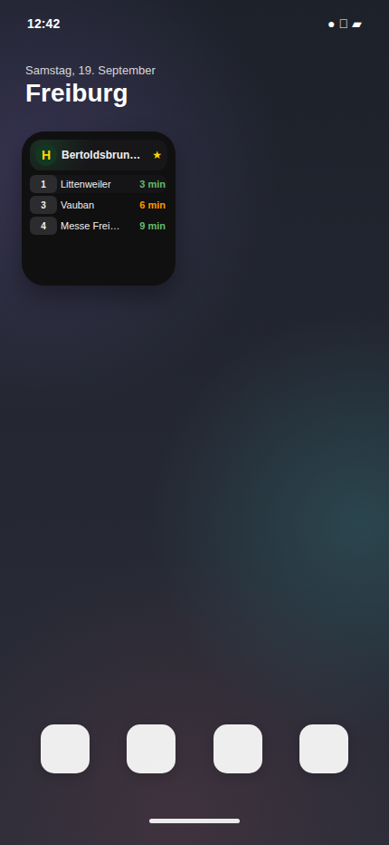
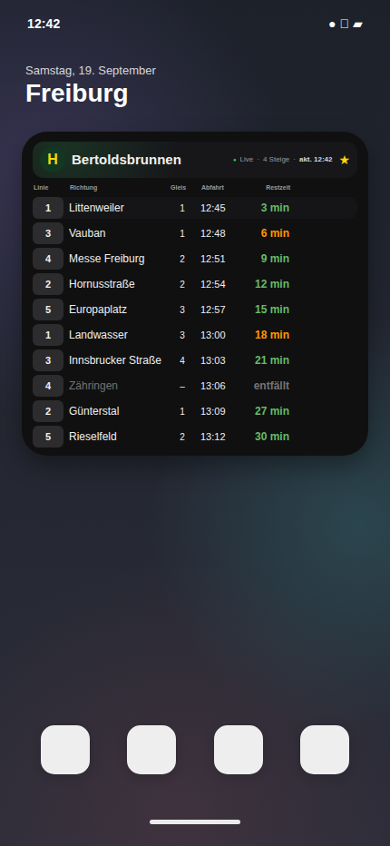
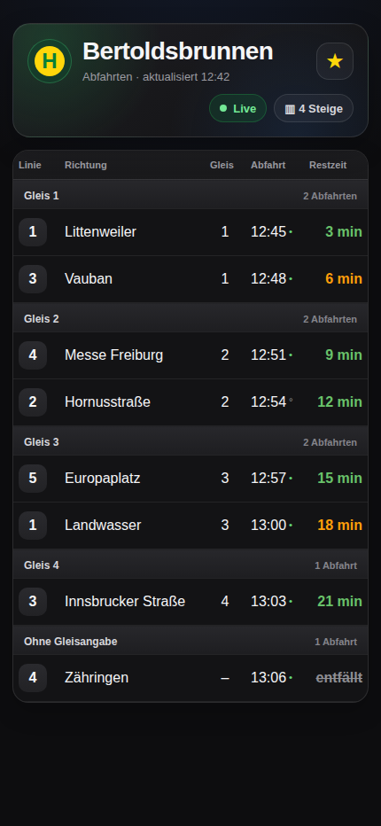
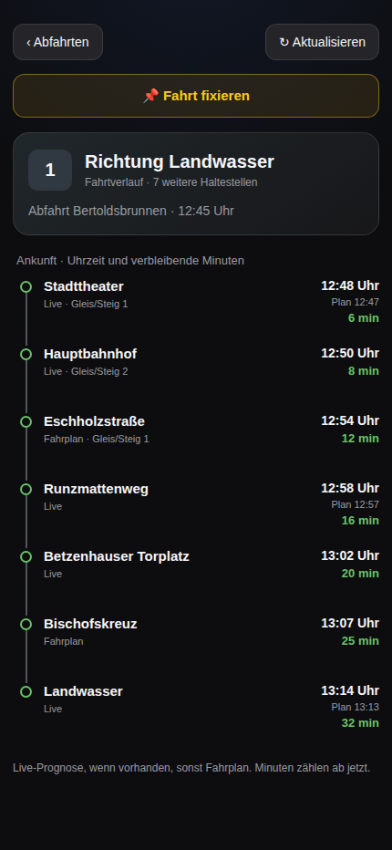
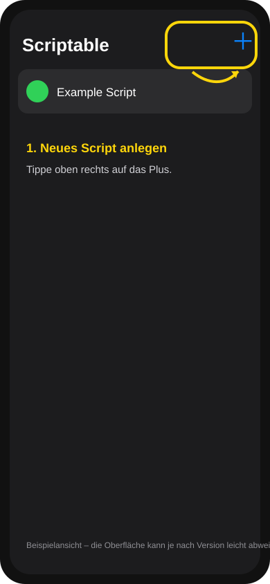
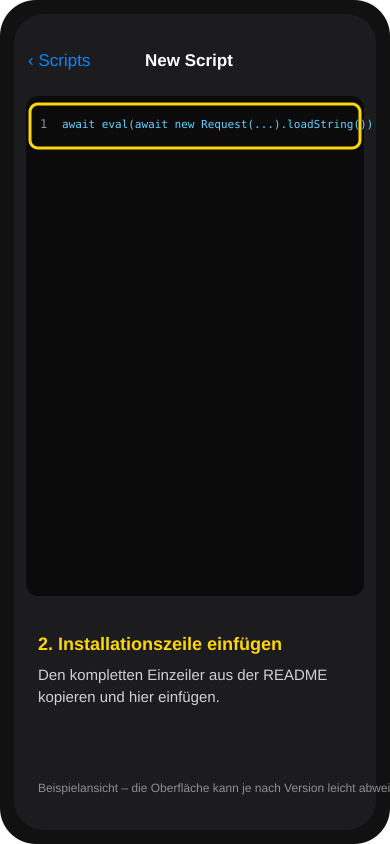
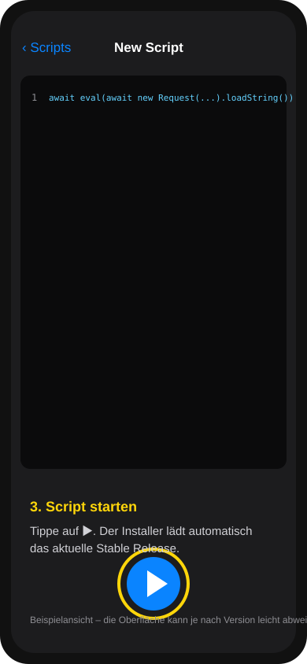
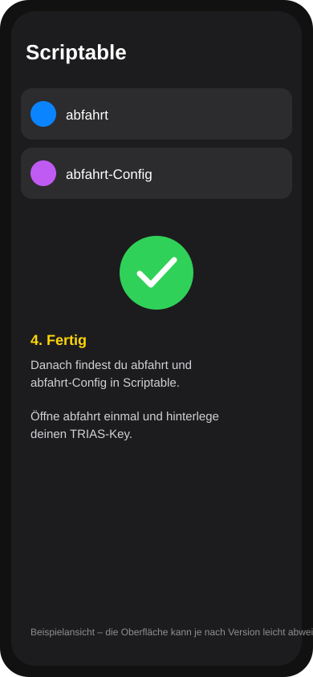

# abfahrt

**Entwicklungsversion: v2.0.18**  
**Stabile Version: v2.0.18**

**abfahrt** zeigt dir auf iPhone und iPad die nächsten Bus-, Straßenbahn- und Zugabfahrten in Baden-Württemberg – direkt als Scriptable-Widget, mit Echtzeitdaten, Verspätungen und Offline-Fallback. Tippe eine Abfahrt an, um die **folgenden Haltestellen mit Ankunftsuhrzeit und Restminuten** zu sehen. Wenn du einsteigst, kannst du die **Fahrt fixieren und später fortsetzen**, auch nachdem sie aus der Abfahrtsliste verschwunden ist.

## Vorschau

<table>
  <tr>
    <td align="center">
      <a href="docs/assets/widget-preview-small.png">
        
      </a>
      <br>
      <sub>Widget klein</sub>
    </td>
    <td align="center">
      <a href="docs/assets/widget-preview-large.png">
        
      </a>
      <br>
      <sub>Widget groß</sub>
    </td>
    <td align="center">
      <a href="docs/assets/fullscreen-preview-platform.png">
        
      </a>
      <br>
      <sub>Fullscreen · nach Gleis sortiert</sub>
    </td>
    <td align="center">
      <a href="docs/assets/trip-normal-preview.png">
        
      </a>
      <br>
      <sub>Fahrtverlauf</sub>
    </td>
  </tr>
</table>

> Die vier Vorschaubilder werden automatisch aus festen Demodaten erzeugt – ohne TRIAS-Key oder Standortzugriff. Ein Klick öffnet die jeweilige PNG-Datei in voller Größe. Der Fahrtverlauf zeigt bewusst eine **noch nicht fixierte** Fahrt.

## Warum gibt es abfahrt?

Die Idee entstand aus einem sehr einfachen Problem: Ich wollte nicht jedes Mal eine große ÖPNV-App öffnen, eine Haltestelle suchen und mich durch mehrere Ansichten tippen, nur um eine Frage zu beantworten:

**Wann kommt die nächste Bahn – und wann muss ich loslaufen?** Und wenn ich schon im Zug sitze: **Wann erreiche ich die nächsten Haltestellen?**

Gerade in einer Stadt mit Straßenbahn ist man oft sowieso in der Nähe einer Haltestelle. Vielleicht sitzt man noch in einer Kneipe, steht bei Freunden vor der Tür oder läuft gerade durch die Innenstadt. Statt zuerst die passende Haltestelle in einer offiziellen App zu suchen, reicht bei abfahrt ein Tap auf das Widget.

Der Ablauf ist bewusst kurz:

```text
Widget antippen
  → falls vorhanden: fixierte Fahrt fortsetzen oder Haltestellen anzeigen
  → sonst: Standort abfragen und nahe Haltestelle auswählen
  → nächste Abfahrten im Vollbild anzeigen
  → Abfahrt antippen: Folgehaltestellen mit Uhrzeiten und Restminuten
  → optional: Fahrt fixieren und später wieder öffnen
```

Das Home-Screen-Widget selbst verwendet **keine dauerhafte Standortabfrage**. Es zeigt die zuletzt aktive Haltestelle und lädt deren Abfahrten. Erst beim interaktiven Öffnen in Scriptable wird bei Bedarf nach dem Standort gefragt. Eine bereits fixierte Fahrt lässt sich sogar **ohne neue GPS-Abfrage** fortsetzen.

abfahrt ist außerdem keine eigene App: Im Kern sind es JavaScript-Dateien, die in [Scriptable](https://scriptable.app/) laufen. Das Projekt ist bewusst leichtgewichtig geblieben, auch wenn inzwischen viele Einstellungen und Komfortfunktionen dazugekommen sind.

## Für wen ist abfahrt gedacht?

abfahrt richtet sich vor allem an Menschen in **Baden-Württemberg**, die möglichst schnell sehen möchten, was an der nächsten Haltestelle fährt.

Besonders praktisch ist es in Städten mit Straßenbahn- oder Stadtbahnnetzen, wenn in der direkten Umgebung nur wenige Haltestellen oder Steige relevant sind. Es funktioniert aber grundsätzlich überall dort, wo die verwendete TRIAS-Schnittstelle von MobiData BW passende Haltestellen- und Abfahrtsdaten liefert.

## Was kann abfahrt?

- **Echtzeit-Abfahrten** über die TRIAS-Schnittstelle von MobiData BW
- Anzeige von **Verspätungen und Ausfällen**
- **GPS-Suche** nach Haltestellen in der Nähe
- automatische Auswahl einer **angepinnten Haltestelle** innerhalb eines konfigurierbaren Radius
- angepinnte Haltestellen mit eigenen Namen und Rollen wie **Home, Work, Love, Pub, Favorite oder Transfer**
- mehrere StopRefs pro logischer Haltestelle, z. B. für mehrere Steige
- optionale **Linien- und Richtungsfilter** pro Haltestelle
- Widgets in **Small, Medium, Large und Extra Large**
- eigene Layout-Einstellungen für jede Widget-Größe
- **Vollbildansicht** mit konfigurierbarer Sortierung nach Abfahrtszeit, Gleis, Richtung oder Linie – inklusive Gruppenüberschriften bei Gleis, Richtung und Linie
- **Interaktiver Fahrtverlauf** für einzelne Abfahrten: Folgehaltestellen, absolute Ankunftszeiten, Restminuten und verfügbare Echtzeitprognosen
- **Fahrt fixieren und fortsetzen**: eine ausgewählte Fahrt lokal merken und nach der Abfahrt erneut öffnen
- **Offline-Fallback** auf vorbereitete GTFS-Sollfahrplandaten für Abfahrten
- automatischer **Stable-/Development-Updater**
- Diagnose, Backup/Wiederherstellung, Recovery und saubere Deinstallation

## Bevor du startest: TRIAS-Requester-Key beantragen

Für Live-Abfahrten benötigt abfahrt einen persönlichen **TRIAS-Requester-Key** von MobiData BW. Ohne diesen Key kann abfahrt keine regulären TRIAS-Anfragen an die EFA-BW-Schnittstelle senden.

Der Zugang wird direkt bei MobiData BW per E-Mail beantragt:

**E-Mail:** [mobidata-bw@nvbw.de](mailto:mobidata-bw@nvbw.de)

MobiData BW bittet aktuell um folgende Angaben:

- Vor- und Nachname
- Name der Institution; bei Privatpersonen reicht der vollständige Name
- Anschrift
- E-Mail-Adresse, die als Kontakt hinterlegt werden soll
- möglichst eine kurze Beschreibung des Projekts bzw. Anwendungsfalls

Eine kurze Beschreibung wie „Privates Scriptable-Widget zur Anzeige von ÖPNV-Abfahrten in Baden-Württemberg über die TRIAS-API“ reicht für den Kontext bereits aus. Die Bearbeitungsdauer wird von MobiData BW nicht verbindlich angegeben.

Offizielle Informationen zum Zugang:  
<https://mobidata-bw.de/dataset/trias>

Mehr Hintergründe dazu findest du unter [TRIAS und Requester-Key](docs/TRIAS.md).

## Schnellinstallation

### 1. Scriptable installieren

Installiere [Scriptable aus dem App Store](https://apps.apple.com/app/scriptable/id1405459188).

### 2. Requester-Key bereithalten

Beantrage zuerst deinen persönlichen TRIAS-Requester-Key wie oben beschrieben.

### 3. Neues Script anlegen

Öffne Scriptable und tippe oben rechts auf **+**.

<p align="center">
  
</p>

### 4. Diese eine Zeile einfügen

Kopiere die folgende Zeile vollständig in das neue Script:

```js
await eval(await new Request("https://raw.githubusercontent.com/ganfer/abfahrt/main/abfahrt-install.js").loadString())
```

<p align="center">
  
</p>

### 5. Installation starten

Tippe in Scriptable auf **▶︎**. Der kleine Bootstrap-Installer ermittelt automatisch das aktuelle **Stable Release** und installiert die benötigten Dateien.

<p align="center">
  
</p>

### 6. abfahrt einmal starten

Nach erfolgreicher Installation findest du in Scriptable:

- `abfahrt`
- `abfahrt-config`

Das temporäre Installationsscript entfernt sich automatisch.

<p align="center">
  
</p>

Starte **`abfahrt` einmal direkt in Scriptable**. Beim ersten Start wirst du nach deinem TRIAS-Requester-Key gefragt. Der Key wird im iOS-Keychain gespeichert und muss nicht im Widget-Parameter hinterlegt werden.

### 7. Widget hinzufügen

Füge auf dem Home Screen ein Scriptable-Widget hinzu und wähle als Script **`abfahrt`**. Das Widget-Parameterfeld kann leer bleiben.

Du kannst Small-, Medium-, Large- oder Extra-Large-Widgets verwenden. Jede Größe besitzt eine eigene Layout-Konfiguration.

> Die gezeigten Scriptable-Ansichten sind vereinfachte Beispielbilder. Je nach iOS- und Scriptable-Version können Positionen oder Symbole leicht abweichen.

## So funktioniert die Nutzung

Das Widget zeigt die Abfahrten der aktuell gespeicherten Haltestelle. Wenn noch nie eine Haltestelle gewählt wurde, verwendet abfahrt **Bertoldsbrunnen in Freiburg** als initialen Standard.

Beim Antippen des Widgets öffnet sich abfahrt in Scriptable:

```text
Home-Screen-Widget
  → falls fixiert: „Aktuelle Fahrt fortsetzen“ oder „Haltestellen anzeigen“
  → sonst: GPS-Standort und Suche nach Haltestellen in der Nähe
  → passende angepinnte Haltestelle automatisch wählen oder manuell auswählen
  → Haltestelle speichern, Widget bei Bedarf aktualisieren
  → Vollbildansicht mit Abfahrten
  → einzelne Abfahrt antippen: Fahrtverlauf anzeigen
```

Wenn GPS nicht verfügbar ist oder keine Haltestelle gefunden wird, kann abfahrt – je nach Einstellung – auf die letzte Haltestelle, **🏠 Home** oder die angepinnten Haltestellen ausweichen.

### Fahrtverlauf: Wo hält meine Bahn als Nächstes?

Tippe in der **Vollbild-Abfahrtsliste** auf eine Straßenbahn-, Bus- oder Zugabfahrt. Die Detailansicht zeigt die gemeldeten folgenden Haltestellen in Fahrtreihenfolge – jeweils mit **Ankunftsuhrzeit (HH:MM)** und **verbleibenden Minuten**.

- **Live**, wenn eine Echtzeitprognose vorhanden ist; andernfalls ausdrücklich **Fahrplan**. Bei Abweichungen erscheint zusätzlich die Planzeit.
- **Aktualisieren** lädt neue Fahrtdaten. Die Restminuten zählen auf dem geöffneten Bildschirm alle 30 Sekunden automatisch weiter, ohne dabei neue Netzabfragen auszulösen.
- **Abfahrten** bringt dich zurück zur Haltestellenliste. Vergangene Halte werden im Fahrtverlauf ausgegraut.

Der Fahrtverlauf benötigt eine passende TRIAS-Fahrtreferenz und gemeldete Folgehaltestellen. Für reine **Offline-GTFS-Abfahrten** ist er nicht verfügbar.

### Fahrt fixieren: Unterwegs die Verbindung wiederfinden

Möchtest du die Fahrt nach dem Einsteigen weiterverfolgen, tippe **📌 Fahrt fixieren** in der Detailansicht. Das Speichern ist **freiwillig**: Das bloße Öffnen einer Abfahrt fixiert sie nicht.

1. Die Abfahrtsliste bietet danach **📌 Aktuelle Fahrt fortsetzen** oberhalb der normalen Abfahrten.
2. Auch beim nächsten Start von `abfahrt` in Scriptable erscheint **Aktuelle Fahrt fortsetzen** **vor** der Standortsuche.
3. Die Fahrt wird direkt anhand ihrer gespeicherten Kennung neu geladen. Sie muss nicht mehr im Abfahrtsmonitor der Einstiegshaltestelle stehen.
4. Mit **📌 Fahrt fixiert · Fixierung lösen** entfernst du die gespeicherte Fahrt wieder. Fixierst du eine andere, ersetzt sie die bisherige.

Du kannst **eine Fahrt pro Gerät** fixieren. Die Fixierung läuft automatisch aus: ungefähr drei Stunden nach der letzten gemeldeten Ankunft, spätestens 72 Stunden nach der planmäßigen Abfahrt. Bei einem vorübergehenden Datenfehler kannst du **Erneut versuchen** oder die Fixierung lösen.

Gespeichert werden die Fahrtreferenz und die zum Wiederöffnen nötigen Fahrtinformationen lokal im **iOS-Keychain**. Der TRIAS-Zugangsschlüssel wird **nicht** in den gespeicherten Fahrt-Datensatz kopiert. Diese Funktion arbeitet in der **Scriptable-Vordergrundansicht** – es gibt keine dauerhafte GPS-Ortung oder Hintergrundverfolgung des Fahrzeugs.

Mehr dazu: **[Fahrtverlauf und fixierte Fahrten](docs/FAHRTVERLAUF.md)**.


## Konfiguration

Starte **`abfahrt-config`** in Scriptable. Änderungen werden beim Verlassen eines Untermenüs automatisch gespeichert.

### Widget

Die Widget-Konfiguration ist in **Allgemein, Small, Medium, Large und Extra Large** aufgeteilt.

Für jede Widget-Größe kannst du unter anderem einstellen:

- Anzahl der Abfahrten
- sichtbare Spalten
- relative Spaltenbreiten
- Zeilen- und Spaltenabstände
- Schriftgrößen
- Badge-Höhe
- Spaltenüberschriften

Unter **Allgemein** liegen größenübergreifende Einstellungen, zum Beispiel die direkte Aktualisierung nach einem Standortwechsel und die Anwendung haltestellenspezifischer Filter.

### Vollbild

Für die Vollbildansicht kannst du unter anderem konfigurieren:

- Anzahl der Abfahrten
- sichtbare Spalten
- relative Spaltenbreiten
- Schriftgröße
- mehrzeilige Zielanzeige
- Anwendung von Haltestellenfiltern
- Sortierung nach **Abfahrtszeit, Gleis, Richtung oder Linie**

Bei Sortierung nach Gleis, Richtung oder Linie werden die Abfahrten zusätzlich mit passenden Gruppenüberschriften gegliedert. Innerhalb jeder Gruppe bleibt die Abfahrtszeit das zweite Sortierkriterium. Die Sortierung nach Abfahrtszeit bleibt eine durchgehende chronologische Liste ohne zusätzliche Überschriften.

### Standort

Die Standortlogik kann automatisch eine angepinnte Haltestelle wählen, wenn sie innerhalb des eingestellten Radius liegt. Standardmäßig beträgt der Radius **200 m**.

Für Fehler bei Standort oder Haltestellensuche stehen folgende Fallbacks zur Verfügung:

- letzte Haltestelle
- **🏠 Home**
- kein Fallback

Wenn **Home** gewählt ist, aber keine Home-Haltestelle existiert, wird die zuletzt aktive Haltestelle verwendet.

### Haltestellen

Haltestellen können aus der Liste zuletzt verwendeter Haltestellen angepinnt oder direkt über TRIAS gesucht werden.

Eine angepinnte Haltestelle kann:

- einen eigenen Anzeigenamen besitzen
- eine Rolle erhalten
- aus mehreren TRIAS-StopRefs bestehen
- Linien per Whitelist oder Blacklist filtern
- Ziele/Richtungen per Whitelist oder Blacklist filtern

Eigene Rollen können mit individuellem Emoji und Namen erstellt werden. Es kann genau eine Home-Haltestelle geben.

### Offline-Daten

TRIAS bleibt immer die primäre Quelle. Wenn eine Abfahrtsanfrage fehlschlägt, kann abfahrt für geeignete angepinnte oder zuletzt verwendete Haltestellen auf lokal zwischengespeicherte **GTFS-Sollfahrplandaten** zurückfallen.

Es werden nur die tatsächlich benötigten Datenshards geladen. Die Daten können automatisch oder manuell aktualisiert werden.

Details: [Offline-GTFS](docs/GTFS.md)

### Updates

Es gibt zwei Update-Kanäle:

- **Stable** – Standard; verwendet das zuletzt bewusst veröffentlichte GitHub Release.
- **Development** – folgt dem aktuellen Stand von `main`.

Stable-Releases werden über ein Manifest mit SHA-256-Prüfsummen verifiziert. Die Config prüft außerdem Dateimarker und Versionen, bevor installierte Dateien ersetzt werden.

### Entwickleroptionen

Unter den Entwickleroptionen findest du:

- **Diagnose** – datenschutzfreundlicher Statusbericht ohne Requester-Key, StopRefs, Haltestellennamen oder Koordinaten
- **Backup & Wiederherstellung** – Export und Import der persönlichen Konfiguration
- **Alle Einstellungen zurücksetzen** – setzt Einstellungen zurück, behält aber angepinnte/zuletzt verwendete Haltestellen und den TRIAS-Key
- **Recovery · Installation reparieren** – stellt Runtime und Config direkt aus dem aktuellen `main` wieder her
- **Deinstallieren · Alles löschen** – entfernt Konfiguration, Haltestellendaten, Cache, Update-Informationen, Requester-Key und verwaltete Scripts

Die persönlichen Einstellungen liegen in **`abfahrt.config.json`**. Kleine Laufzeitdaten und der Requester-Key werden im iOS-Keychain gespeichert.

## Standardwerte

| Einstellung | Standard |
| --- | --- |
| Abfahrten im Small Widget | 3 |
| Abfahrten im Medium Widget | 5 |
| Abfahrten im Large Widget | 10 |
| Abfahrten im Extra-Large Widget | 14 |
| Abfahrten im Vollbild | 8 |
| Vollbild-Sortierung | Abfahrtszeit |
| Automatische angepinnte Haltestelle | An |
| Radius für automatische Auswahl | 200 m |
| Standort-Fallback | Letzte Haltestelle |
| Widget nach Standortwechsel direkt aktualisieren | An |
| Haltestellenfilter im Widget | An |
| Haltestellenfilter im Vollbild | An |
| Update-Kanal | Stable |

TRIAS-Abfragen werden an die aktive Widget- oder Vollbildkonfiguration angepasst und auf **1–30 Ergebnisse** begrenzt.

## Datenschutz und Akku

abfahrt ist so aufgebaut, dass Standortzugriffe bewusst im Vordergrund stattfinden:

- Das Home-Screen-Widget verwendet die gespeicherte aktive Haltestelle.
- GPS wird beim interaktiven Start von abfahrt angefragt, nicht dauerhaft im Hintergrund.
- Der TRIAS-Requester-Key liegt im iOS-Keychain.
- Eine ausdrücklich fixierte Fahrt wird ebenfalls lokal im Keychain gespeichert; dafür werden Fahrtreferenz, Einstiegsdaten, Linie und Richtung hinterlegt, aber nicht der TRIAS-Key kopiert.
- Diagnoseausgaben enthalten bewusst keine Key-Werte, StopRefs, Haltestellennamen oder Koordinaten.
- Offline-Daten werden nur für relevante Haltestellen lokal gespeichert.

## Fehlerbehebung

Wenn der TRIAS-Key abgelehnt wird, prüfe zuerst den gespeicherten Key und ob dein Zugang von MobiData BW aktiv ist.

Wenn kein Standort verfügbar ist, prüfe die Standortberechtigung von Scriptable unter iOS. Mit aktiviertem Fallback kann abfahrt trotzdem die letzte, die Home- oder eine angepinnte Haltestelle verwenden. Eine **fixierte Fahrt** lässt sich ohne neue Standortabfrage fortsetzen.

Wenn **kein Fahrtverlauf** angezeigt wird, fehlen möglicherweise die nötigen Fahrtreferenzen oder Folgehaltestellen in der TRIAS-Antwort. Bei einem vorübergehenden Fehler einer fixierten Fahrt nutze **Erneut versuchen**. Aus reinen Offline-GTFS-Abfahrten kann kein Fahrtverlauf geladen werden.

Bei Update- oder Installationsproblemen starte zuerst:

**abfahrt-config → Entwickleroptionen → Diagnose**

Wenn Runtime oder Config beschädigt sind, steht zusätzlich **Recovery · Installation reparieren** zur Verfügung.

## Dokumentation

- [TRIAS und Requester-Key](docs/TRIAS.md) – Zugang, verwendete TRIAS-Abfragen, Key-Speicherung und Fehlerbilder
- [Module und Komponenten](docs/MODULES.md) – technische Übersicht über Runtime, Config, Installer, Hilfsskripte, Workflows und Tests
- [Architektur](docs/ARCHITECTURE.md) – Zusammenspiel der Komponenten, Datenflüsse, Persistenz und Update-Modell
- [Offline-GTFS](docs/GTFS.md) – Aufbau und Aktualisierung des Offline-Fahrplans
- [Fahrtverlauf und Fahrt fixieren](docs/FAHRTVERLAUF.md) – nächste Haltestellen, Ankunftszeiten, Merken und Fortsetzen einer Fahrt
- [Vorschau-Screenshots](docs/SCREENSHOTS.md) – automatische Erzeugung aller vier README-Vorschaubilder

## Entwicklung

Bei jedem Push auf `main` und bei jedem Pull Request läuft die CI mit **Node 22**.

Sie prüft:

- JavaScript-Syntax
- Regressionstests
- Versionskonsistenz
- Repository-Verträge

Die Tests decken unter anderem TRIAS-Requests und -Parsing, Gleiserkennung, Standort- und Pin-Logik, Fahrtverlauf, Fixieren/Fortsetzen einer Fahrt, Updater und nutzerfreundliche Fehlerzustände ab.

Lokal können die Regressionstests so gestartet werden:

```sh
node --test test/*.test.js
```

Ein separater Workflow erzeugt außerdem **vier deterministische README-Vorschauen**: kleines Widget, großes Widget, Vollbild nach Gleis sortiert und normaler Fahrtverlauf.

## Versionierung

`abfahrt.js` und `abfahrt-config.js` teilen sich dieselbe **`APP_VERSION`**. Der Bootstrap-Installer ist absichtlich versionslos.

- **Entwicklungsversion** = aktuelle `APP_VERSION` auf `main`
- **Stabile Version** = zuletzt veröffentlichtes Stable Release auf GitHub

Änderungen an Runtime oder Config erhöhen die Entwicklungsversion automatisch im Pull Request. Ein Merge nach `main` veröffentlicht nicht automatisch ein neues Stable Release.

## Datenquelle und Hinweis

Die Live-Daten stammen aus der TRIAS-Schnittstelle von **MobiData BW / NVBW**. Die Offline-Sollfahrplandaten basieren ebenfalls auf dem landesweiten Datenangebot von MobiData BW / NVBW.

abfahrt ist ein unabhängiges Open-Source-Projekt und kein offizielles Angebot von MobiData BW, NVBW, Scriptable oder einem Verkehrsverbund.

## Lizenz

MIT.
